# University of Vavuniya LMS: Demo Application Build Guide
## ER diagrams, system design diagrams and step-by-step build plan

**Document status:** Build guide for a working demo
**Version:** 1.1 (database changed from PostgreSQL to **MySQL 8.4 + MySQL Workbench**)
**Date:** 2026-10-11
**Companion to:** *System Design v2.0* (the target design). This guide builds a **demo-sized slice** of it.

> **Database note.** v1.0 targeted PostgreSQL. v1.1 uses MySQL. The PostgreSQL-only features are replaced as follows: partial unique index → generated column + unique index (§6.6); `pg_trgm` → FULLTEXT ngram index (§6.7); advisory lock → `GET_LOCK` (§9.6). Locking rules for InnoDB are in §9.5, and Workbench setup is in §14.4.

> **How to read this.** All diagrams are [Mermaid](https://mermaid.js.org). They render in GitHub/GitLab, VS Code (with a Mermaid preview extension), and at mermaid.live. Items marked **[DECISION]** are policy choices the demo fixes with a default so you can build now; the library must confirm them before production. Effort figures are planning estimates.

---

## 1. Demo Goals and Scope

### 1.1 Purpose

Show stakeholders a **working, end-to-end circulation system** on realistic data, and prove the risky parts (concurrency, fines, reminders, import) before the full build.

### 1.2 In scope

| Area | Demo features |
|---|---|
| Accounts | Local login (session + CSRF), roles `ADMIN`, `LIBRARIAN`, `MEMBER`, password reset by email |
| Catalog | Books, authors, categories, collections, copies with barcodes (accession numbers), search (title/author/ISBN/call number) |
| Circulation | Issue, return (by barcode), renew; loan rules by patron category, year and section; closed-day calendar |
| Fines | Automatic fine on late return; payment / waiver / adjustment ledger |
| Notifications | Due and final-reminder emails via a background worker (captured by Mailpit in dev) |
| Patrons | Member list, loan history, graduation clearance check |
| Admin | Rules and calendar editor, audit log viewer, failed-jobs view, CSV import with dry-run |
| Demo tools | A controllable clock to show reminders and fines without waiting |

### 1.3 Out of scope for the demo

Holds/reservations, the research repository, file uploads, SSO, MFA, backups/binary-log PITR, high availability, Sinhala/Tamil UI translations (the code is i18n-ready; English strings only). Each is already designed in *System Design v2.0* (phases v1.1 and later).

### 1.4 Personas

| Persona | Goal in the demo |
|---|---|
| **Librarian** (circulation desk) | Scan patron and book, issue/return quickly, collect fines |
| **Member** (student/lecturer) | Search the catalog, see own loans, due dates and fines |
| **Admin** | Edit rules and closed days, review audit, run imports, retry failed jobs |

---

## 2. Technology Stack

| Layer | Choice | Notes |
|---|---|---|
| Frontend | React + TypeScript + Vite | React Router, TanStack Query, react-hook-form + zod, an accessible component library (e.g., Mantine or shadcn/ui), react-i18next |
| API | Python 3.12+, Django 5.2 LTS, Django REST Framework | `drf-spectacular` for OpenAPI. **Verify current supported versions when you start.** |
| Database | MySQL 8.4 LTS (InnoDB, `utf8mb4`), driver `mysqlclient` | Generated column + unique index for "one active loan", `SELECT ... FOR UPDATE [SKIP LOCKED]`, FULLTEXT search with the ngram parser, `GET_LOCK` named locks (see §6.7) |
| DB tool | **MySQL Workbench** | Schema setup script, browsing data, EER diagram (reverse engineer), watching locks during demos (§14.4) |
| Jobs | Table-backed queue + one worker process (`manage.py run_worker`) | No broker; see §9.6 |
| Email | Django SMTP backend; **Mailpit** in dev | Console backend as fallback |
| Dev environment | Docker Compose | Services: `db` (MySQL; optional if you use a local MySQL Server), `mailpit`, `web`, `worker`, `frontend` |
| Tests | pytest + pytest-django, Vitest + Testing Library, Playwright (one smoke path) | |

---

## 3. System Context

Who uses the system and what it talks to.

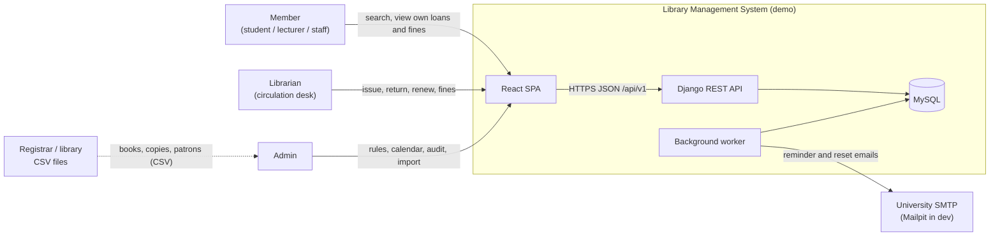

---

## 4. Containers and Deployment

### 4.1 Dev / demo topology (Docker Compose)

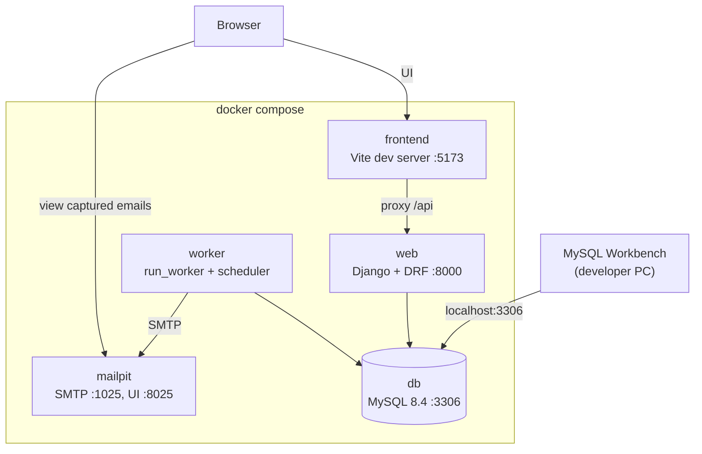

The Vite dev server **proxies `/api` to Django**, so the browser sees one origin. Cookies and CSRF then behave exactly as in production, and no CORS configuration is needed.

### 4.2 Production-like topology (staging / demo server)

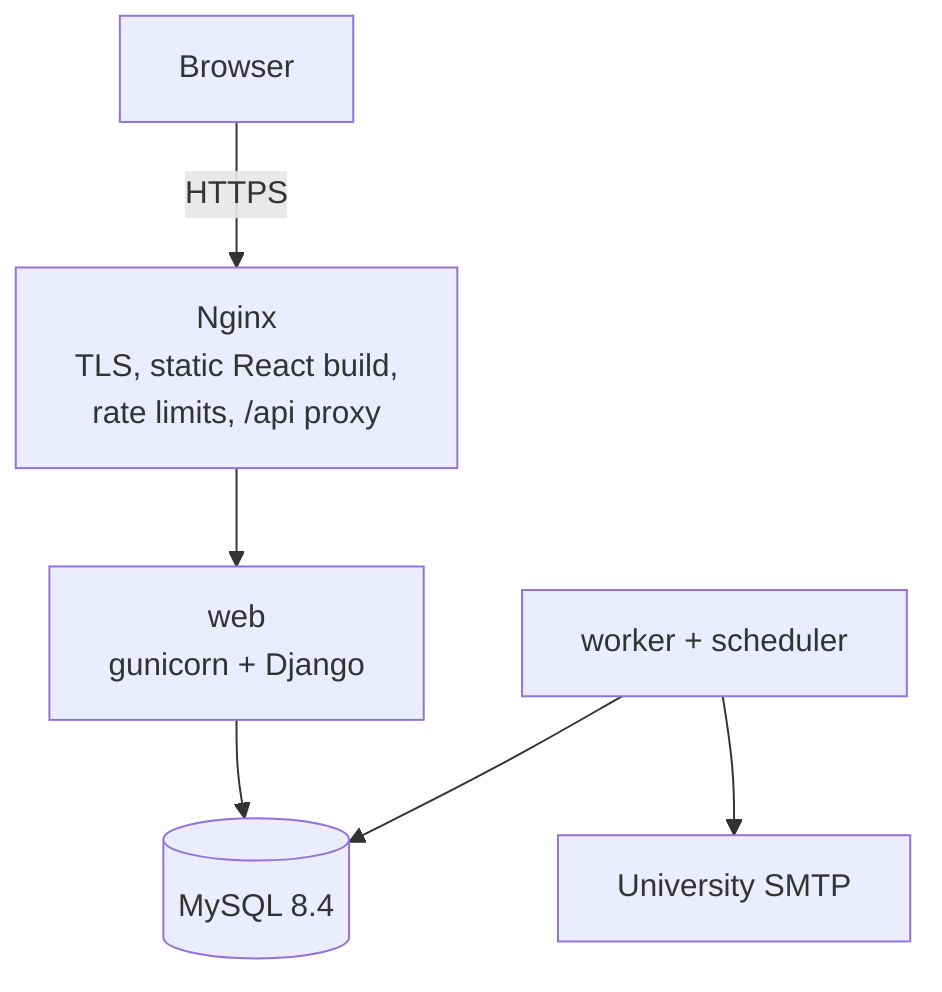

---

## 5. Backend Components

### 5.1 Django apps and allowed dependencies

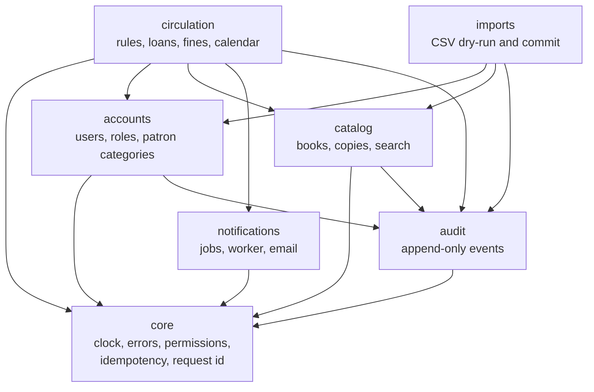

**Module rules** (enforce in code review):

1. Views are thin: validate with serializers, call a **service function**, return a response.
2. All business rules live in `services/*.py` inside each app. Views and serializers never contain rule logic.
3. An app calls another app only through its services, never by writing to its tables.
4. `core.clock.now()` is the only source of "current time" (see §9.1). Never call `timezone.now()` directly.
5. Anything that changes money, permissions, policy or loans writes an `AuditEvent` **in the same transaction**.

### 5.2 Service functions to implement

| App | Services |
|---|---|
| `circulation` | `issue_copy`, `return_copy`, `renew_loan`, `compute_due_at`, `compute_fine`, `record_fine_transaction`, `check_clearance`, `scan_reminders` |
| `catalog` | `search_books`, `set_copy_status`, `create_copy` |
| `accounts` | `create_patron`, `set_patron_status`, `academic_year_of` |
| `notifications` | `enqueue`, `claim_jobs`, `run_job`, `send_email` |
| `imports` | `validate_csv`, `apply_import` |

---

## 6. Data Model

MySQL 8.4 LTS (InnoDB, `utf8mb4`). Money is `DECIMAL(10,2)` in LKR. Timestamps are `DATETIME(6)` stored in UTC and shown in `Asia/Colombo` (UTC+05:30, no daylight saving). See §6.7 for MySQL-specific choices.

### 6.1 Overview (relationships only)

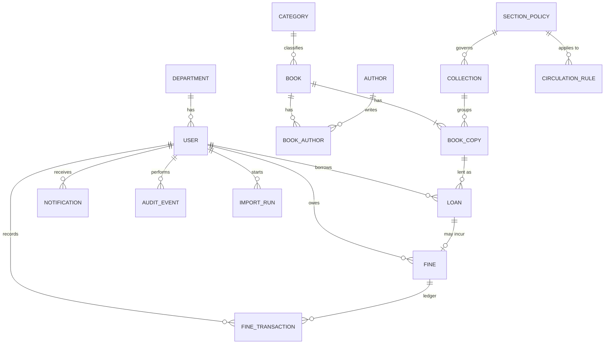

### 6.2 People, rules and calendar

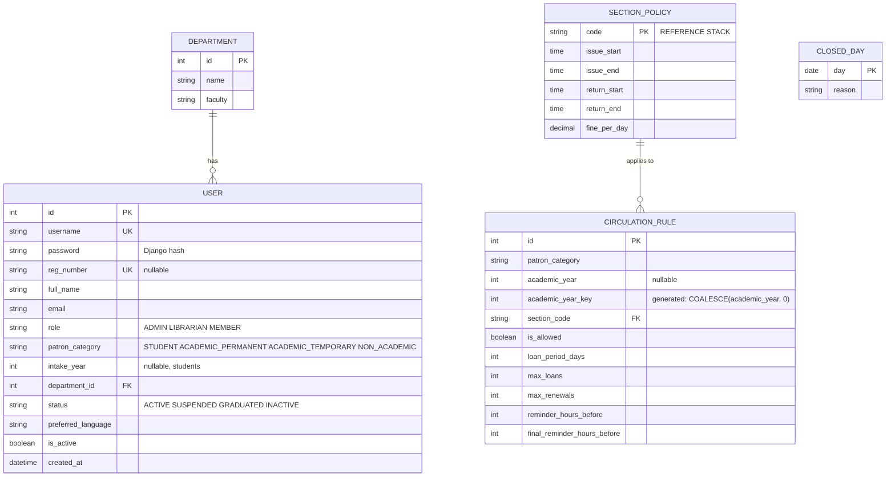

Constraints: `CIRCULATION_RULE` unique on (`patron_category`, `academic_year_key`, `section_code`), where `academic_year_key` is a generated column `COALESCE(academic_year, 0)`. MySQL unique indexes allow repeated `NULL`s, so the raw nullable column cannot be used (§6.6). Academic year is **computed** from `intake_year` (§9.2), never stored.

### 6.3 Catalog

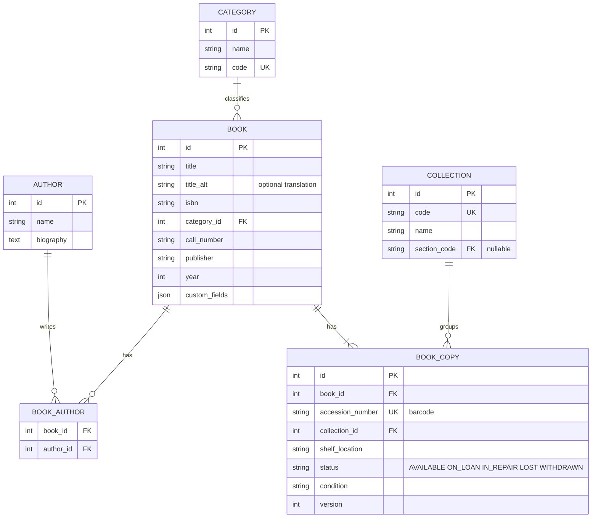

Constraints: `BOOK_AUTHOR` unique pair; `accession_number` unique; FULLTEXT index (ngram parser) on `BOOK(title, title_alt)` and `AUTHOR(name)` (§6.7); B-tree on `isbn`, `call_number`, `status`. A copy whose collection has **no section** is never borrowable.

### 6.4 Circulation and fines

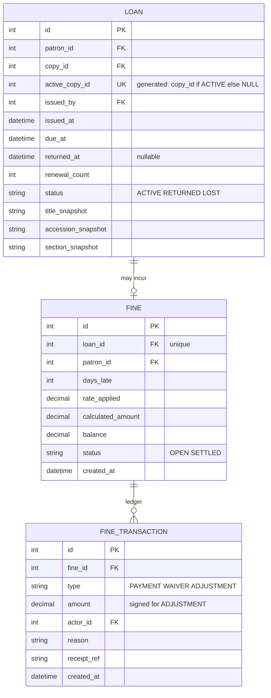

Fine balance rule: `balance = calculated_amount + sum(ADJUSTMENT) - sum(PAYMENT) - sum(WAIVER)`. The ledger is **append-only**; `FINE.balance` and `FINE.status` are updated in the same transaction as each ledger row.

### 6.5 Platform tables (jobs, notifications, audit, imports, idempotency)

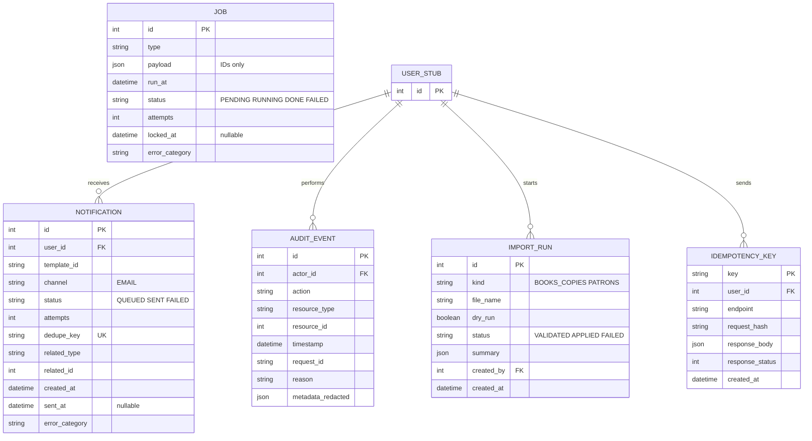

`USER_STUB` stands for the `USER` table (shown separately in §6.2). `AUDIT_EVENT` is append-only: the application's MySQL runtime user gets only `SELECT, INSERT` on that table (§14.4).

### 6.6 Constraints that protect correctness

| Rule | Implementation (MySQL 8.x / InnoDB) |
|---|---|
| One active loan per copy | MySQL has **no partial indexes**. Add a generated column `LOAN.active_copy_id = CASE WHEN status='ACTIVE' THEN copy_id END` with a **unique index**. Rows that are not active hold `NULL`, and MySQL allows any number of `NULL`s in a unique index. |
| One fine per loan | Unique on `FINE(loan_id)` |
| No duplicate notifications | Unique `NOTIFICATION(dedupe_key)` |
| Accession numbers unique | Unique `BOOK_COPY(accession_number)` (the `utf8mb4_0900_ai_ci` collation also makes `a-0001` and `A-0001` collide, which is what we want) |
| Rule uniqueness | Generated column `CIRCULATION_RULE.academic_year_key = COALESCE(academic_year, 0)`, unique on (`patron_category`, `academic_year_key`, `section_code`). A unique index on the nullable column alone would allow duplicate `NULL`-year rules. |
| No negative renewals / amounts | `CHECK` constraints (enforced since MySQL 8.0.16) |
| Ledger is append-only | No update/delete endpoints; table-level `GRANT SELECT, INSERT` on the audit table for the runtime user (§14.4) |

> [!WARNING]
> Do **not** use `UniqueConstraint(..., condition=Q(...))` on MySQL. Django drops it silently (system check warning `models.W036`), and nothing protects you from double loans. Use the generated-column pattern below.

Django 5.2 example (`GeneratedField` is supported on MySQL; `CheckConstraint` takes `condition=`, which replaced `check=`):

```python
from django.db import models
from django.db.models import Case, F, Q, Value, When
from django.db.models.functions import Coalesce

class Loan(models.Model):
    class Status(models.TextChoices):
        ACTIVE = "ACTIVE"
        RETURNED = "RETURNED"
        LOST = "LOST"

    patron = models.ForeignKey("accounts.User", on_delete=models.PROTECT, related_name="loans")
    copy = models.ForeignKey("catalog.BookCopy", on_delete=models.PROTECT, related_name="loans")
    issued_by = models.ForeignKey("accounts.User", on_delete=models.PROTECT, related_name="+")
    issued_at = models.DateTimeField()
    due_at = models.DateTimeField()
    returned_at = models.DateTimeField(null=True, blank=True)
    renewal_count = models.PositiveSmallIntegerField(default=0)
    status = models.CharField(max_length=10, choices=Status.choices, default=Status.ACTIVE)
    title_snapshot = models.CharField(max_length=500)
    accession_snapshot = models.CharField(max_length=50)
    section_snapshot = models.CharField(max_length=20)

    # copy_id while ACTIVE, NULL otherwise -> unique index = "one active loan per copy"
    # (MySQL rule: an FK on a stored generated column's base column must not use CASCADE/SET NULL.
    #  Django's PROTECT is enforced in Python, so the DB FK has no ON DELETE action. OK.)
    active_copy_id = models.GeneratedField(
        expression=Case(When(status="ACTIVE", then=F("copy")), default=Value(None)),
        output_field=models.BigIntegerField(null=True),
        db_persist=True,                       # STORED generated column
    )

    class Meta:
        constraints = [
            models.UniqueConstraint(fields=["active_copy_id"], name="uniq_active_loan_per_copy"),
            models.CheckConstraint(condition=Q(renewal_count__gte=0), name="loan_renewals_non_negative"),
        ]
        indexes = [models.Index(fields=["patron", "status"]), models.Index(fields=["status", "due_at"])]


class CirculationRule(models.Model):
    patron_category = models.CharField(max_length=30)
    academic_year = models.PositiveSmallIntegerField(null=True, blank=True)
    section = models.ForeignKey("circulation.SectionPolicy", on_delete=models.PROTECT, db_column="section_code")
    # ... loan_period_days, max_loans, max_renewals, reminder hours ...
    academic_year_key = models.GeneratedField(
        expression=Coalesce(F("academic_year"), Value(0)),
        output_field=models.PositiveSmallIntegerField(),
        db_persist=True,
    )

    class Meta:
        constraints = [
            models.UniqueConstraint(
                fields=["patron_category", "academic_year_key", "section"], name="uniq_circulation_rule",
            ),
        ]
```

Generated columns are read-only. Never set `active_copy_id` or `academic_year_key` in code. After `save()`, call `refresh_from_db(fields=[...])` if you need the value. The column appears in MySQL Workbench with the `STORED GENERATED` flag.

### 6.7 MySQL-specific notes

| Topic | Choice |
|---|---|
| Version / engine | MySQL **8.4 LTS** (minimum 8.0.16 for enforced `CHECK`; Django 5.2 requires 8.0.11+), InnoDB only |
| Character set | `utf8mb4` with collation `utf8mb4_0900_ai_ci` on the server, schema and connection. Never use `utf8`/`utf8mb3`: Sinhala, Tamil and emoji need 4-byte support. |
| Timestamps | `DATETIME(6)` stored in UTC (Django `USE_TZ=True`). Load the MySQL time zone tables (§14.1). |
| Money | `DECIMAL(10,2)` |
| JSON | Native `JSON` column (Django `JSONField`) |
| Isolation | `READ COMMITTED` (§9.5) |
| Strict mode | `STRICT_TRANS_TABLES` so bad data errors instead of being truncated |
| Index key length | InnoDB limit is 3072 bytes = 768 `utf8mb4` characters. Keep indexed `CharField`s at 500 characters or fewer. |

**Catalog search (replaces PostgreSQL `pg_trgm`).** Create a FULLTEXT index with the **ngram** parser. It splits text into 2-character tokens, so it handles partial words and non-Latin scripts without word boundaries. Django has no FULLTEXT field, so add it with a migration:

```python
# catalog/migrations/0002_fulltext.py
from django.db import migrations

class Migration(migrations.Migration):
    dependencies = [("catalog", "0001_initial")]
    operations = [
        migrations.RunSQL(
            "ALTER TABLE catalog_book ADD FULLTEXT INDEX ft_book_title (title, title_alt) WITH PARSER ngram",
            reverse_sql="ALTER TABLE catalog_book DROP INDEX ft_book_title",
        ),
        migrations.RunSQL(
            "ALTER TABLE catalog_author ADD FULLTEXT INDEX ft_author_name (name) WITH PARSER ngram",
            reverse_sql="ALTER TABLE catalog_author DROP INDEX ft_author_name",
        ),
    ]
```

```python
# catalog/services/search.py
from django.db.models import Q
from django.db.models.expressions import RawSQL

def search_books(q: str):
    q = q.strip()
    if looks_like_isbn(q):
        return Book.objects.filter(isbn=normalise_isbn(q))                    # B-tree, exact
    if looks_like_call_number(q):
        return Book.objects.filter(call_number__istartswith=q)                # B-tree, prefix LIKE 'q%'
    match = "MATCH(catalog_book.title, catalog_book.title_alt) AGAINST (%s IN BOOLEAN MODE)"
    author_ids = Author.objects.extra(
        where=["MATCH(name) AGAINST (%s IN BOOLEAN MODE)"], params=[q]
    ).values("id")
    return (Book.objects
            .annotate(score=RawSQL(match, [q]))
            .filter(Q(score__gt=0) | Q(bookauthor__author_id__in=author_ids))
            .distinct()
            .order_by("-score", "title"))
```

- Always pass the search term as a **parameter**, never by string formatting (SQL injection).
- Strip the boolean operators `+ - > < ( ) ~ * " @` from user input, or escape them, before `AGAINST`.
- Search terms shorter than `ngram_token_size` (default 2) do not match. Fall back to `title__istartswith` for 1-character queries.
- Keep a B-tree index on `isbn`, `call_number` and `BOOK_COPY.status`; `LIKE 'abc%'` uses them, but `LIKE '%abc%'` does not.

---

## 7. Lifecycles (State Diagrams)

### 7.1 Copy status

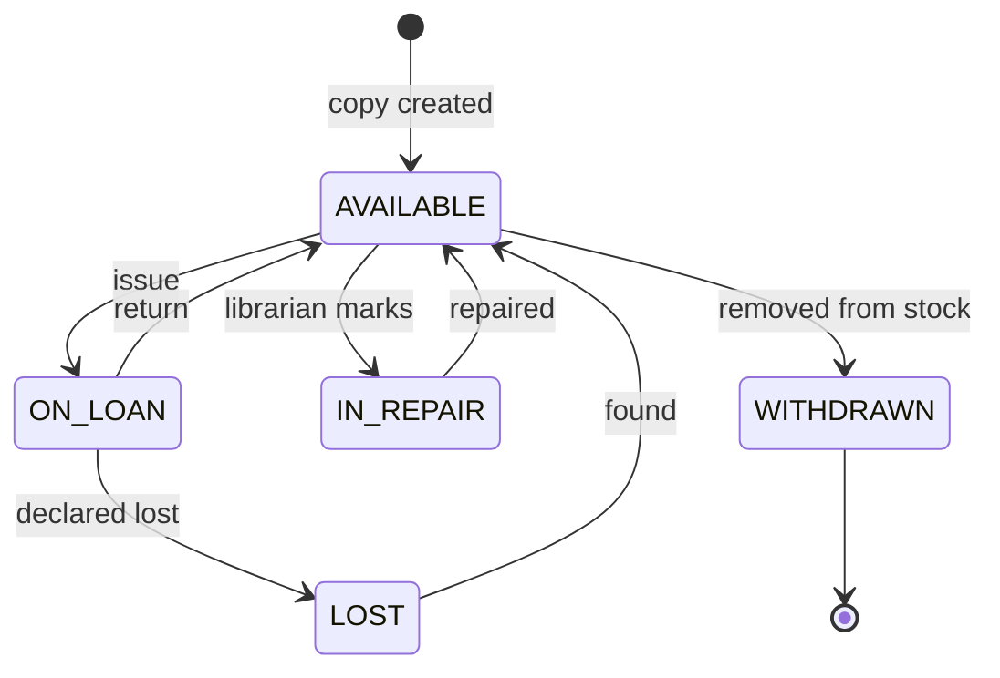

(`HOLD_SHELF` is added in the holds phase.)

### 7.2 Loan status

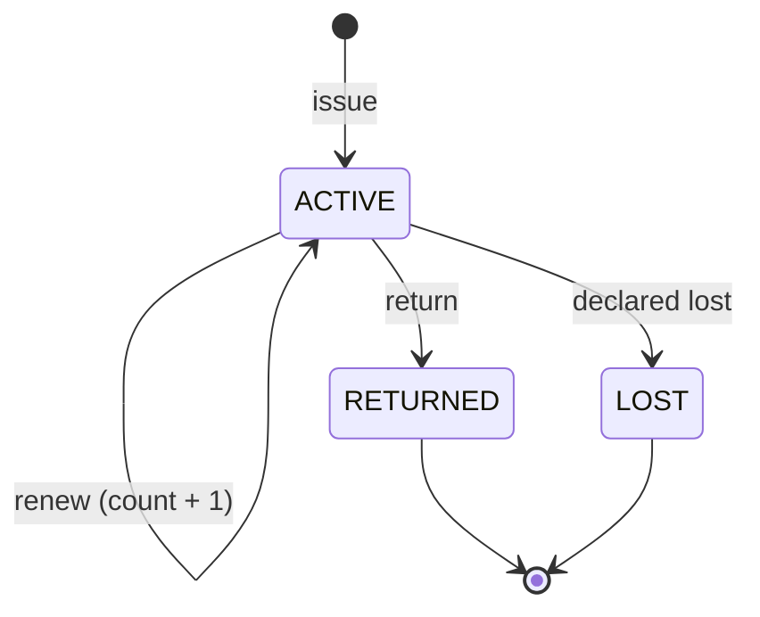

"Overdue" is **derived** (`status = ACTIVE and due_at < now`), not a stored state.

### 7.3 Fine status

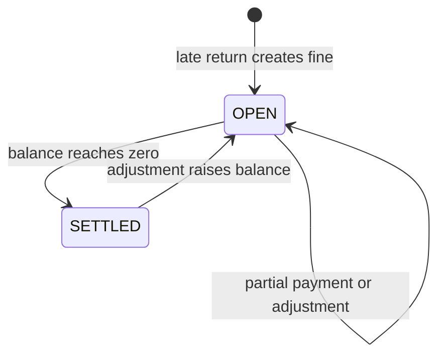

### 7.4 Patron status

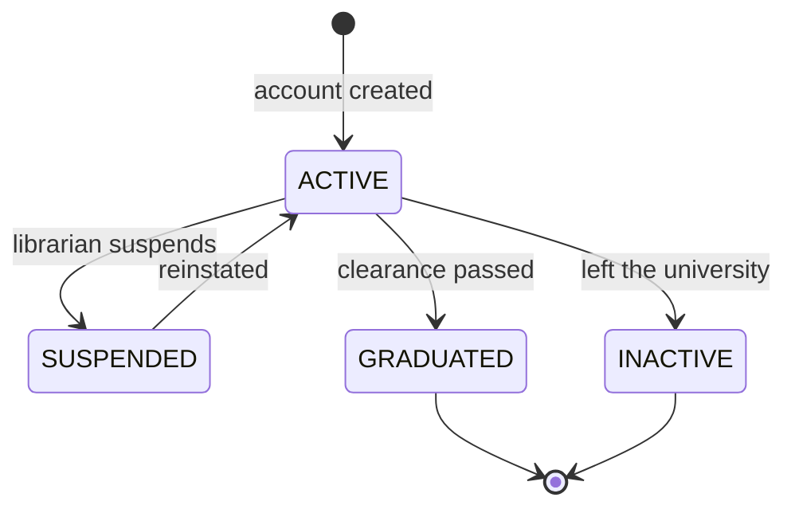

---

## 8. Key Workflows

### 8.1 Login (session + CSRF)

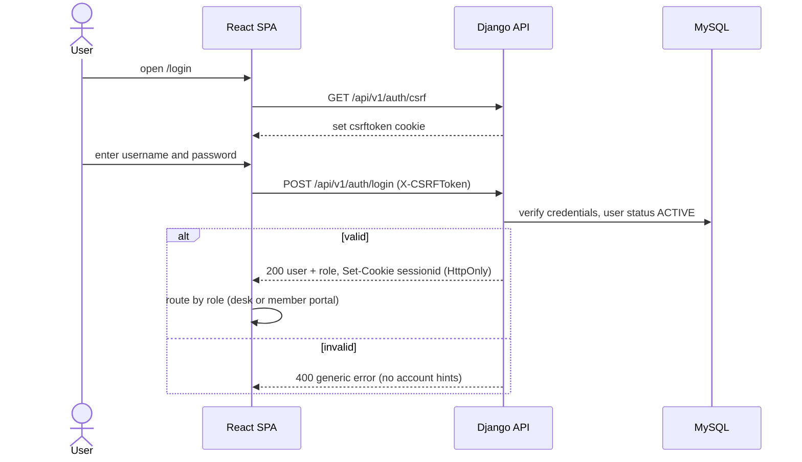

### 8.2 Issue a book (circulation desk)

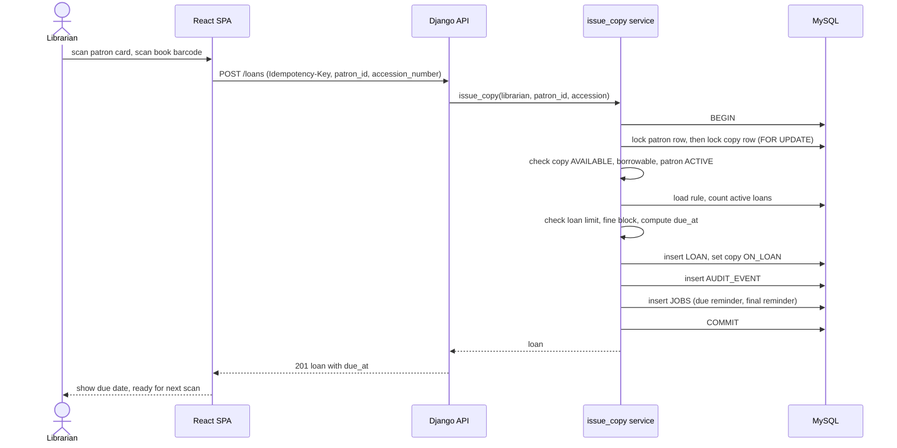

On any rule failure the service raises a typed error and the transaction rolls back (see error codes, §10.3).

### 8.3 Issue validation (decision flow)

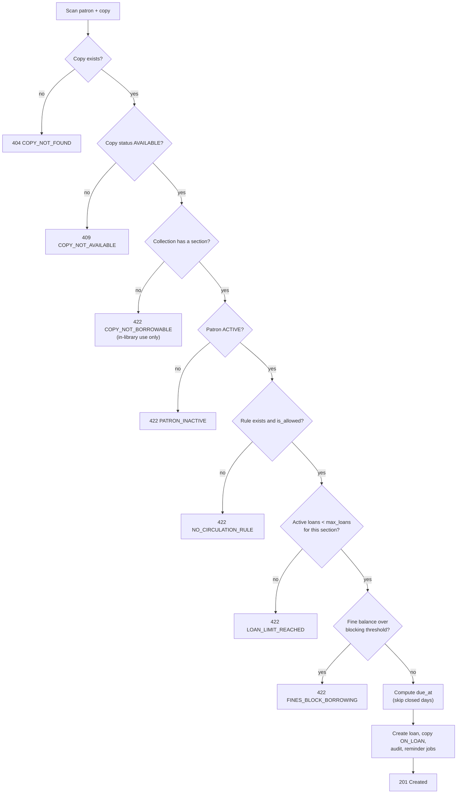

### 8.4 Return a book and assess a fine

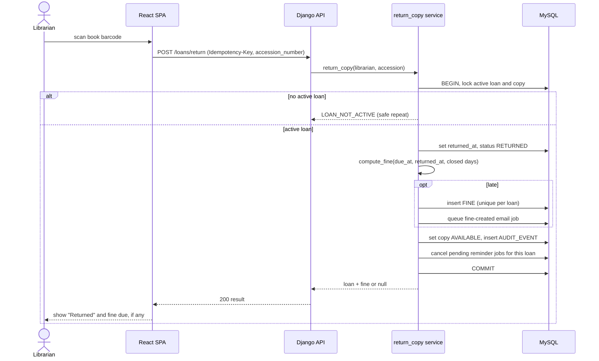

### 8.5 Reminder scheduler and email worker

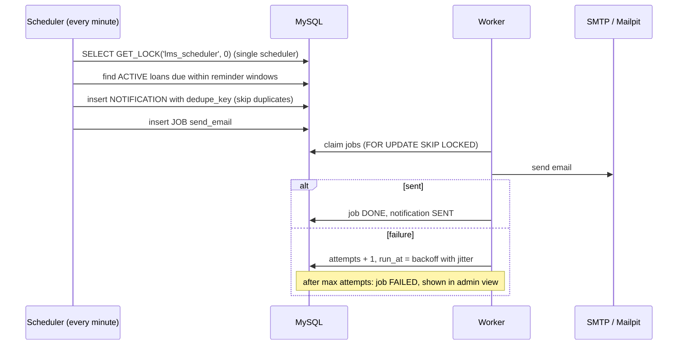

Dedupe key format: `due_reminder:{loan_id}:{due_date}:{stage}`. Re-running the scan is therefore harmless.

### 8.6 CSV import (dry-run, then apply)

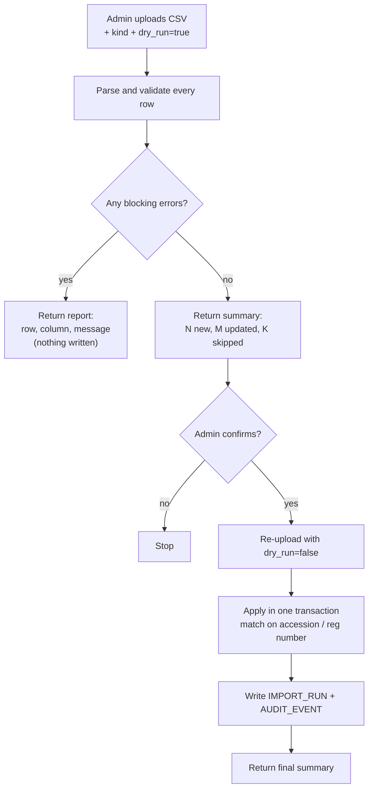

---

## 9. Business Logic Specifications

### 9.1 Clock

All time goes through one function so the demo can fast-forward.

```python
# core/clock.py
from datetime import timedelta
from django.conf import settings
from django.utils import timezone

def now():
    offset = get_demo_offset_days() if settings.DEMO_CLOCK_ENABLED else 0   # stored in a one-row table
    return timezone.now() + timedelta(days=offset)
```

A lint/test rule fails the build if `timezone.now()` or `datetime.now()` appears outside `core/clock.py`. The admin "Demo tools" page sets the offset (`POST /admin/demo/clock`) and is **disabled unless `DEMO_CLOCK_ENABLED=true`**.

### 9.2 Academic year

```python
def academic_year_of(user, today) -> int | None:
    if user.patron_category != "STUDENT" or user.intake_year is None:
        return None
    # academic year starts on ACADEMIC_YEAR_START (month, day), default (1, 1) [DECISION]
    start_year = today.year if (today.month, today.day) >= settings.ACADEMIC_YEAR_START else today.year - 1
    return max(1, min(settings.MAX_STUDENT_YEAR, start_year - user.intake_year + 1))
```

`MAX_STUDENT_YEAR` defaults to 4 **[DECISION]** (some programmes may differ).

### 9.3 Due date

```python
def compute_due_at(issued_at, rule, section, closed_days, weekly_closed):
    d = issued_at.astimezone(COLOMBO).date() + timedelta(days=rule.loan_period_days)
    while d in closed_days or d.weekday() in weekly_closed:
        d += timedelta(days=1)                       # roll forward to the next open day [DECISION]
    return datetime.combine(d, section.return_end, tzinfo=COLOMBO)
```

### 9.4 Fine calculation

One function, no duplicates elsewhere:

```python
def compute_fine(due_at, returned_at, rate, closed_days, weekly_closed, grace=timedelta(0)):
    if returned_at <= due_at + grace:
        return 0, Decimal("0.00")
    start = due_at.astimezone(COLOMBO).date()        # exclusive
    end = returned_at.astimezone(COLOMBO).date()     # inclusive
    days = 0
    d = start + timedelta(days=1)
    while d <= end:
        if settings.COUNT_CLOSED_DAYS_IN_FINES or not (d in closed_days or d.weekday() in weekly_closed):
            days += 1
        d += timedelta(days=1)
    days = max(days, 1)                              # returned late on the due date itself counts one day [DECISION]
    return days, rate * days
```

Store `days_late`, `rate_applied` and `calculated_amount` on the `FINE` row so every amount can be explained later.

### 9.5 Concurrency pattern

- **Lock order is always `patron -> copy -> loan`.** A fixed order prevents deadlocks.
- Locking the **patron** row serialises two simultaneous issues to the same patron, so the max-loan check cannot be raced.
- The unique index on the generated column `LOAN.active_copy_id` (§6.6) is the **last line of defence**. If code ever misses a lock, the database still rejects the second loan. Map `IntegrityError` (MySQL error 1062) to `409 COPY_NOT_AVAILABLE`.
- Return is idempotent: a second return of the same barcode finds no active loan and responds with the stored result for the same `Idempotency-Key`, or `LOAN_NOT_ACTIVE`.

**InnoDB specifics:**

- Run at **READ COMMITTED** (set in `DATABASES.OPTIONS`, §14.2). InnoDB's default REPEATABLE READ takes gap locks, which cause extra deadlocks on inserts into unique indexes.
- MySQL has **no `FOR UPDATE OF`** (Django: `supports_select_for_update_of = False`). `select_for_update().select_related(...)` therefore locks **every joined row**: book, collection and section. Locking the section would serialise every issue in that section. Lock the copy **alone**, then read related rows without locks.
- Lock rows by **primary key or a unique index** only (`pk`, `accession_number`). A lock on a non-indexed filter can lock many rows.
- InnoDB can still pick a deadlock victim (error **1213**). Retry the whole transaction up to 3 times with short jitter, and only then return `409`.

```python
from django.db import IntegrityError, OperationalError, transaction

MYSQL_DEADLOCK, MYSQL_LOCK_WAIT_TIMEOUT = 1213, 1205

def with_deadlock_retry(fn, attempts=3):
    for i in range(attempts):
        try:
            return fn()
        except OperationalError as e:
            if e.args[0] not in (MYSQL_DEADLOCK, MYSQL_LOCK_WAIT_TIMEOUT) or i == attempts - 1:
                raise
            sleep_with_jitter(i)

@transaction.atomic
def _issue_copy(*, librarian, patron_id, accession_number):
    copy_id = BookCopy.objects.values_list("id", flat=True).get(accession_number=accession_number)  # 404 if missing
    patron = User.objects.select_for_update().get(pk=patron_id)                  # lock 1
    copy = BookCopy.objects.select_for_update().get(pk=copy_id)                  # lock 2 (copy row only)
    book = Book.objects.get(pk=copy.book_id)                                     # plain reads, no locks
    collection = Collection.objects.select_related("section").get(pk=copy.collection_id)
    # ... rule checks from the flow in 8.3 ...
    try:
        with transaction.atomic():                                               # savepoint
            loan = Loan.objects.create(...)
    except IntegrityError:
        raise CopyNotAvailable()
    copy.status = "ON_LOAN"; copy.save(update_fields=["status", "version"])
    audit.log(librarian, "loan.issue", "loan", loan.id)
    notifications.enqueue_reminders(loan)
    return loan

def issue_copy(**kwargs):
    return with_deadlock_retry(lambda: _issue_copy(**kwargs))
```

### 9.6 Job queue (table-backed)

```python
def claim_jobs(limit=10):
    with transaction.atomic():
        jobs = list(Job.objects.select_for_update(skip_locked=True)
                    .filter(status="PENDING", run_at__lte=now()).order_by("run_at", "id")[:limit])
        Job.objects.filter(id__in=[j.id for j in jobs]).update(status="RUNNING", locked_at=now())
    return jobs
```

- Handlers must be **idempotent** (check `Notification.dedupe_key` before sending).
- Retry delay: exponential backoff with jitter; after the maximum attempts (default 5) the job becomes `FAILED` and appears in the admin view with a **Retry** button (audited).
- A reaper moves `RUNNING` jobs older than 10 minutes back to `PENDING`.
- One scheduler at a time: MySQL named lock `SELECT GET_LOCK('lms_scheduler', 0)` (returns `1` if acquired, `0` if another scheduler holds it). The lock belongs to the **database session**. Hold it on a dedicated connection that stays open for the scheduler's lifetime (do not rely on `CONN_MAX_AGE` recycling). MySQL frees it automatically if the process dies. Record a heartbeat (last successful run) and show it on the admin page.

```python
# notifications/scheduler.py
from django.db import connection

def try_become_scheduler() -> bool:
    with connection.cursor() as cur:
        cur.execute("SELECT GET_LOCK(%s, 0)", ["lms_scheduler"])
        return cur.fetchone()[0] == 1
```

- `SELECT ... FOR UPDATE SKIP LOCKED` (used by `claim_jobs`) is supported on MySQL 8.0.1+ and Django sends it as written.

### 9.7 Idempotency

State-changing desk endpoints (`POST /loans`, `/loans/return`, `/loans/{id}/renew`, fine transactions) require an `Idempotency-Key` header (UUID generated by the SPA per user action). The server stores `(key, user, endpoint, request_hash, response)`; the same key with the same body replays the stored response, and the same key with a different body returns `409 IDEMPOTENCY_CONFLICT`.

### 9.8 Demo settings

| Setting | Demo default | Meaning |
|---|---|---|
| `TIME_ZONE` | `Asia/Colombo` | Fixed offset, no DST |
| `LIBRARY_CLOSED_WEEKDAYS` | `[6]` (Sunday) | Weekly closure **[DECISION]** |
| `ENFORCE_ISSUE_HOURS` | `False` | Turn on to reject issues outside `SectionPolicy` hours |
| `GRACE_MINUTES` | `0` | Late grace **[DECISION]** |
| `COUNT_CLOSED_DAYS_IN_FINES` | `False` | Closed days do not accrue fines **[DECISION]** |
| `BLOCK_ISSUE_IF_FINE_BALANCE_OVER` | `None` | Fines do not block borrowing unless set **[DECISION]** |
| `ACADEMIC_YEAR_START` | `(1, 1)` | Month/day an academic year begins **[DECISION]** |
| `DEMO_CLOCK_ENABLED` | `True` in demo only | Enables the clock tool |

### 9.9 Renewal rules

- Loan must be `ACTIVE`, not overdue, and `renewal_count < max_renewals` (Stack 2, Reference 0).
- New `due_at` is computed from **now** using the same due-date function.
- Audit every renewal; staff override of the overdue rule requires a reason.

---

## 10. API Specification

Base path `/api/v1/`. JSON. Session cookie + `X-CSRFToken` on unsafe methods. OpenAPI is generated by `drf-spectacular` at `/api/v1/schema/`.

### 10.1 Endpoints

| Area | Method and path | Roles |
|---|---|---|
| Auth | `GET /auth/csrf`, `POST /auth/login`, `POST /auth/logout`, `GET /auth/me` | all |
| Auth | `POST /auth/password-reset`, `POST /auth/password-reset/confirm` | public |
| Catalog | `GET /books?q=&category=&available=`, `GET /books/{id}` | all authenticated |
| Catalog | `POST /books`, `PATCH /books/{id}` | LIBRARIAN, ADMIN |
| Copies | `GET /books/{id}/copies`, `POST /copies`, `PATCH /copies/{id}`, `POST /copies/{id}/status` | LIBRARIAN, ADMIN |
| Lookups | `GET/POST /categories`, `/authors`, `/collections` | read: all, write: LIBRARIAN, ADMIN |
| Patrons | `GET /patrons?q=`, `GET /patrons/{id}`, `POST /patrons`, `PATCH /patrons/{id}` | LIBRARIAN, ADMIN |
| Patrons | `GET /patrons/{id}/loans`, `GET /patrons/{id}/clearance` | LIBRARIAN, ADMIN |
| Circulation | `POST /loans`, `POST /loans/return`, `POST /loans/{id}/renew` | LIBRARIAN, ADMIN |
| Circulation | `GET /loans?status=&patron=&overdue=`, `GET /loans/{id}` | LIBRARIAN, ADMIN |
| Circulation | `GET /loans/mine` | MEMBER |
| Fines | `GET /fines?status=`, `POST /fines/{id}/transactions` | LIBRARIAN, ADMIN (large waivers: ADMIN **[DECISION]**) |
| Fines | `GET /fines/mine` | MEMBER |
| Admin | `GET/PUT /admin/rules`, `GET/PUT /admin/sections` | ADMIN |
| Admin | `GET/POST/DELETE /admin/closed-days` | ADMIN |
| Admin | `GET /admin/audit`, `GET /admin/jobs`, `POST /admin/jobs/{id}/retry` | ADMIN |
| Admin | `POST /admin/imports`, `GET /admin/imports/{id}` | ADMIN |
| Demo | `POST /admin/demo/clock` (offset in days) | ADMIN, only if `DEMO_CLOCK_ENABLED` |
| Health | `GET /healthz`, `GET /readyz` | public (minimal output) |

### 10.2 Example: issue

Request:

```http
POST /api/v1/loans
Idempotency-Key: 6b0e0d9e-8b7c-4a45-9c8e-0a6f2f1a0c11
Content-Type: application/json

{ "patron_id": 7, "accession_number": "A-000123" }
```

Response `201`:

```json
{
  "id": 1042,
  "patron": { "id": 7, "full_name": "Nimal Perera", "reg_number": "2023/ICT/014" },
  "copy": { "accession_number": "A-000123", "status": "ON_LOAN" },
  "title": "Introduction to Algorithms",
  "section": "STACK",
  "issued_at": "2026-11-02T10:15:00+05:30",
  "due_at": "2026-11-09T17:00:00+05:30",
  "renewal_count": 0,
  "status": "ACTIVE",
  "request_id": "req_01HZX..."
}
```

### 10.3 Example: return

Request: `POST /api/v1/loans/return` with `{ "accession_number": "A-000123" }`

Response `200` (late by two open days):

```json
{
  "loan": { "id": 1042, "status": "RETURNED", "returned_at": "2026-11-12T11:00:00+05:30" },
  "fine": { "id": 311, "days_late": 2, "rate_applied": "10.00", "calculated_amount": "20.00", "balance": "20.00", "status": "OPEN" },
  "copy_status": "AVAILABLE"
}
```

`fine` is `null` when the book is on time. (Amounts above are illustrative; real rates come from `SectionPolicy`.)

### 10.4 Error format and codes

```json
{ "error": { "code": "LOAN_LIMIT_REACHED", "message": "Patron has reached the limit of 3 STACK loans.",
             "fields": {}, "request_id": "req_01HZX..." } }
```

| Code | HTTP | Meaning |
|---|---:|---|
| `VALIDATION_ERROR` | 400 | Field errors in `fields` |
| `UNAUTHENTICATED` / `FORBIDDEN` | 401 / 403 | No session / not allowed |
| `COPY_NOT_FOUND` | 404 | Unknown accession number |
| `COPY_NOT_AVAILABLE` | 409 | Already on loan, in repair, lost or withdrawn |
| `COPY_NOT_BORROWABLE` | 422 | Collection has no section |
| `PATRON_INACTIVE` | 422 | Not `ACTIVE` |
| `NO_CIRCULATION_RULE` | 422 | No rule, or `is_allowed = false` |
| `LOAN_LIMIT_REACHED` | 422 | `max_loans` reached |
| `FINES_BLOCK_BORROWING` | 422 | Balance over threshold (if enabled) |
| `OUTSIDE_ISSUE_HOURS` | 422 | Only if `ENFORCE_ISSUE_HOURS` |
| `LOAN_NOT_ACTIVE` | 409 | Already returned or lost |
| `RENEWAL_LIMIT_REACHED` / `LOAN_OVERDUE` | 422 | Renewal blocked |
| `IDEMPOTENCY_CONFLICT` | 409 | Same key, different body |
| `RATE_LIMITED` | 429 | Too many requests |

### 10.5 Conventions

- Pagination on every list (`page`, `page_size` with a maximum); server-side sorting and bounded filters.
- Every response carries `X-Request-ID`; the same ID is in logs and audit rows.
- No stack traces or SQL in responses.
- Rate limits (Nginx and DRF throttling) on login, password reset, search and import.

---

## 11. Authorization Matrix

Deny by default. One central permission module; object-level checks everywhere.

| Capability | MEMBER | LIBRARIAN | ADMIN |
|---|:---:|:---:|:---:|
| Search catalog | yes | yes | yes |
| View own loans and fines | yes | n/a | n/a |
| View any patron, loan or fine | no | yes | yes |
| Issue / return / renew | no | yes | yes |
| Create/edit books and copies | no | yes | yes |
| Record payments and small waivers | no | yes | yes |
| Large waivers and adjustments **[DECISION limit]** | no | no | yes |
| Create/edit patrons, set status | no | yes | yes |
| Edit rules, sections, closed days | no | no | yes |
| View audit log, jobs, imports | no | no | yes |
| Manage roles | no | no | yes |

Security tests required: a member cannot read another member's loan or fine by changing the ID in the URL (IDOR/BOLA), and a librarian cannot reach admin endpoints.

---

## 12. Frontend

### 12.1 Routes and screens

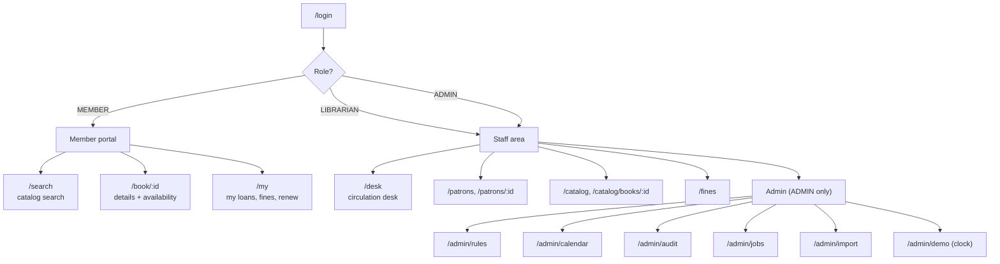

### 12.2 Circulation desk (the screen to get right)

Keyboard- and barcode-scanner-first. A scanner types characters then Enter, so inputs submit on Enter and focus returns to the scan box after every action.

```
+--------------------------------------------------------------------------------+
|  CIRCULATION DESK                                  [Issue] [Return] [Renew]    |
+--------------------------------------------------------------------------------+
|  Patron:  [ scan card or type reg no.  ]   Nimal Perera  2023/ICT/014          |
|           Student, year 3   ACTIVE   Loans 2 of 4 (STACK)   Fines Rs 0.00      |
+--------------------------------------------------------------------------------+
|  Book:    [ scan accession no.        ]   >> A-000123  Introduction to Algo...  |
|                                                                                |
|  Result:  OK  Issued. Due Mon 09 Nov 2026, 5:00 PM                             |
|           (error banners: red, with the reason and what to do next)            |
+--------------------------------------------------------------------------------+
|  Current loans                                                                 |
|  Accession   Title                        Due            Status    Action      |
|  A-000087    Operating Systems            05 Nov 17:00   Overdue 3d [Renew]    |
|  A-000123    Introduction to Algorithms   09 Nov 17:00   Active     [Renew]    |
+--------------------------------------------------------------------------------+
|  Session log: last 10 actions (undo is not allowed; use Return)                |
+--------------------------------------------------------------------------------+
```

### 12.3 Frontend conventions

- Server state with TanStack Query; no global store beyond auth/user context.
- One typed API client generated from the OpenAPI schema.
- Every desk mutation sends a fresh `Idempotency-Key`.
- Form validation with zod mirrors serializer rules; the server is still authoritative.
- All user-facing strings go through i18n keys (English only in the demo).
- Accessibility: labelled inputs, visible focus, errors announced to screen readers, colour never the only signal (target WCAG 2.2 AA on core journeys).
- Show times in `Asia/Colombo`; never format dates by hand.

---

## 13. Repository Structure

```
lms/
├── docker-compose.yml
├── .env.example
├── README.md
├── db/
│   └── init/
│       └── 01_schema_and_users.sql   # schema + users (run in MySQL Workbench, or auto-run by Docker)
├── docs/
│   ├── system-design-v2.md
│   └── demo-build-guide.md
├── backend/
│   ├── manage.py
│   ├── pyproject.toml
│   ├── config/                 # settings (base, dev, prod), urls, wsgi
│   └── apps/
│       ├── core/               # clock, errors, permissions, idempotency, middleware
│       ├── accounts/           # models, services, serializers, views
│       ├── catalog/
│       ├── circulation/
│       │   ├── models.py
│       │   ├── services/       # issue.py, return_.py, renew.py, fines.py, calendar.py, reminders.py
│       │   ├── serializers.py
│       │   ├── views.py
│       │   └── tests/
│       ├── notifications/      # Job, Notification, worker, scheduler, templates
│       ├── audit/
│       ├── imports/
│       └── demo/               # seed_demo command, clock tool
└── frontend/
    ├── package.json
    ├── vite.config.ts          # /api proxy to :8000
    └── src/
        ├── api/                # generated client
        ├── auth/
        ├── features/           # desk, patrons, catalog, fines, admin, member
        ├── components/
        ├── i18n/
        └── routes.tsx
```

---

## 14. Local Setup

You can run MySQL in one of two ways. Both work with **MySQL Workbench**.

| Option | When to use | `DB_HOST` for `web`/`worker` |
|---|---|---|
| **A. MySQL in Docker** (the `db` service below) | Same setup for every developer; easy reset | `db` |
| **B. Local MySQL Server on Windows** (installed with MySQL Installer, which also installs Workbench) | You already have MySQL Server + Workbench | `host.docker.internal` (Django in Docker) or `127.0.0.1` (Django run directly) |

For option B, delete the `db` service and the `depends_on: [db]` entries, then follow §14.4 in Workbench.

### 14.1 `docker-compose.yml` (dev)

```yaml
services:
  db:
    image: mysql:8.4          # MySQL 8.4 LTS; Django 5.2 needs MySQL 8.0.11+
    command:
      - --character-set-server=utf8mb4
      - --collation-server=utf8mb4_0900_ai_ci
      - --transaction-isolation=READ-COMMITTED
      - --default-time-zone=+00:00
    environment:
      MYSQL_DATABASE: lms
      MYSQL_USER: lms
      MYSQL_PASSWORD: ${DB_PASSWORD}
      MYSQL_ROOT_PASSWORD: ${DB_ROOT_PASSWORD}
      TZ: UTC
    volumes:
      - mysqldata:/var/lib/mysql
      - ./db/init:/docker-entrypoint-initdb.d:ro   # runs *.sql once, on first start
    ports: ["3306:3306"]       # MySQL Workbench connects to localhost:3306
    healthcheck:
      test: ["CMD", "mysqladmin", "ping", "-h", "localhost", "-uroot", "-p${DB_ROOT_PASSWORD}"]
      interval: 5s
      retries: 20

  mailpit:
    image: axllent/mailpit
    ports: ["1025:1025", "8025:8025"]

  web:
    build: ./backend
    command: python manage.py runserver 0.0.0.0:8000
    env_file: .env
    depends_on:
      db: { condition: service_healthy }
    ports: ["8000:8000"]
    volumes: ["./backend:/app"]

  worker:
    build: ./backend
    command: python manage.py run_worker   # worker + scheduler
    env_file: .env
    depends_on:
      db: { condition: service_healthy }
      mailpit: { condition: service_started }
    volumes: ["./backend:/app"]

  frontend:
    build: ./frontend
    command: npm run dev -- --host
    ports: ["5173:5173"]
    volumes: ["./frontend:/app"]

volumes:
  mysqldata:
```

The official `mysql` image loads the time zone tables on first start. Django needs them because `USE_TZ=True` with `TIME_ZONE="Asia/Colombo"` produces `CONVERT_TZ(..., 'UTC', 'Asia/Colombo')` in date lookups. On a **local Windows MySQL** these tables are empty. Download the POSIX time zone SQL from dev.mysql.com (*MySQL Time Zone Support*), then run it on the `mysql` schema in Workbench. Check with `SELECT CONVERT_TZ(NOW(), 'UTC', 'Asia/Colombo');`; the result must not be `NULL`.

**Backend image:** `mysqlclient` needs native libraries. In `backend/Dockerfile` (based on `python:3.12-slim`):

```dockerfile
RUN apt-get update && apt-get install -y --no-install-recommends \
        build-essential pkg-config default-libmysqlclient-dev \
    && rm -rf /var/lib/apt/lists/*
```

On Windows, `pip install mysqlclient` installs a prebuilt wheel, so nothing extra is needed.

### 14.2 `.env.example`

```
DJANGO_SECRET_KEY=change-me
DJANGO_DEBUG=true
DB_ENGINE=django.db.backends.mysql
DB_NAME=lms
DB_USER=lms
DB_PASSWORD=change-me
DB_ROOT_PASSWORD=change-me-root      # Docker option only; never used by the app
DB_HOST=db                           # option B: host.docker.internal or 127.0.0.1
DB_PORT=3306
EMAIL_HOST=mailpit
EMAIL_PORT=1025
DEMO_CLOCK_ENABLED=true
DEMO_PASSWORD=change-me-for-seeded-users
```

Never commit real secrets. `.env` is git-ignored.

`config/settings/base.py`:

```python
DATABASES = {
    "default": {
        "ENGINE": "django.db.backends.mysql",
        "NAME": env("DB_NAME"),
        "USER": env("DB_USER"),
        "PASSWORD": env("DB_PASSWORD"),
        "HOST": env("DB_HOST"),
        "PORT": env("DB_PORT", default="3306"),
        "CONN_MAX_AGE": 60,
        "OPTIONS": {
            "charset": "utf8mb4",                     # needed for Sinhala/Tamil and emoji
            "isolation_level": "read committed",      # Django's recommended level on MySQL
            "init_command": "SET sql_mode='STRICT_TRANS_TABLES,NO_ZERO_DATE,NO_ZERO_IN_DATE,ERROR_FOR_DIVISION_BY_ZERO'",
        },
        "TEST": {"NAME": "test_lms", "CHARSET": "utf8mb4", "COLLATION": "utf8mb4_0900_ai_ci"},
    }
}
USE_TZ = True
TIME_ZONE = "Asia/Colombo"
DEFAULT_AUTO_FIELD = "django.db.models.BigAutoField"
```

### 14.3 First run

```bash
cp .env.example .env            # edit values
docker compose up -d db mailpit # option B: skip "db"; make sure the local MySQL service is running
docker compose run --rm web python manage.py migrate
docker compose run --rm web python manage.py seed_demo
docker compose up web worker frontend
# App: http://localhost:5173    API docs: http://localhost:8000/api/v1/schema/swagger/
# Captured emails: http://localhost:8025
# Database: MySQL Workbench -> localhost:3306, user lms
```

The `migrate` step creates the FULLTEXT indexes (a `RunSQL` migration, §6.7), the generated columns and the unique indexes. Run `python manage.py check --database default` once. It must show **no `mysql.W002`** (strict mode) warning and **no `models.W036`** warning. W036 means a conditional `UniqueConstraint` was silently ignored.

### 14.4 MySQL Workbench setup

1. **Connect.** In Workbench, open *Database > Manage Connections > New*. Use Hostname `127.0.0.1`, Port `3306`, and Username `root` for setup. Click *Test Connection*.
2. **Create the schema and users.** Open a SQL tab and run the script below. Save it as `db/init/01_schema_and_users.sql`. With the Docker option, the script runs automatically on first start (the `lms` schema and user then already exist; `IF NOT EXISTS` makes that harmless).

```sql
-- db/init/01_schema_and_users.sql
CREATE DATABASE IF NOT EXISTS lms
  CHARACTER SET utf8mb4 COLLATE utf8mb4_0900_ai_ci;

-- Migration user: owns the schema (CREATE/ALTER/INDEX) and the test database.
CREATE USER IF NOT EXISTS 'lms'@'%' IDENTIFIED BY 'change-me';
GRANT ALL PRIVILEGES ON lms.*      TO 'lms'@'%';
GRANT ALL PRIVILEGES ON test_lms.* TO 'lms'@'%';   -- pytest creates/drops test_lms

-- Optional runtime user (production-like): DML only.
CREATE USER IF NOT EXISTS 'lms_app'@'%' IDENTIFIED BY 'change-me-app';
GRANT SELECT, INSERT, UPDATE, DELETE ON lms.* TO 'lms_app'@'%';
FLUSH PRIVILEGES;
```

   > **Append-only audit table:** MySQL cannot `REVOKE` one table from a schema-level (`lms.*`) grant. In production, give `lms_app` per-table grants instead, with only `SELECT, INSERT` on `lms.audit_auditevent` (a small script can generate these after `migrate`). The demo can use the single `lms` user.

3. **Add a second connection** as user `lms`, default schema `lms`. Use it daily to browse tables. *Database > Reverse Engineer* draws an EER diagram from the migrated schema; compare it with §6.
4. **Useful demo queries** (save them as Workbench snippets):

```sql
SELECT id, copy_id, active_copy_id, status, due_at FROM circulation_loan ORDER BY id DESC LIMIT 20;
SELECT type, status, attempts, run_at, error_category FROM notifications_job ORDER BY id DESC LIMIT 20;
SELECT * FROM performance_schema.data_locks;        -- watch InnoDB row locks during the concurrency demo
SELECT IS_USED_LOCK('lms_scheduler');               -- which connection holds the scheduler lock
```

---

## 15. Seed Data and Demo Script

### 15.1 Seed data (`manage.py seed_demo`)

All values are **proposed seeds**; the library must confirm them before production **[DECISION]**.

**Sections**

| Code | Fine per day (demo) | Hours |
|---|---:|---|
| `REFERENCE` | Rs 10.00 | issue 08:30 to 15:00, return 08:30 to 16:00 |
| `STACK` | Rs 10.00 | issue 08:30 to 15:00, return 08:30 to 16:00 |

**Collections:** Reference (REFERENCE), Lending (STACK), Permanent Reference (no section), Bound Periodical (no section).

**Circulation rules (from current project policy)**

| Patron category | Year | Reference (days / max) | Stack (days / max) |
|---|---:|---|---|
| Student | 1 | 1 / 1 | 7 / 2 |
| Student | 2 | 1 / 1 | 7 / 3 |
| Student | 3 | 1 / 1 | 7 / 4 |
| Student | 4 | 1 / 1 | 7 / 4 |
| Academic permanent | n/a | 7 / 2 | 30 / 6 |
| Academic temporary | n/a | 7 / 2 | 30 / 2 |
| Non-academic | n/a | not allowed | 7 / 2 |

Max renewals: Stack 2, Reference 0. Reminders: 24 h before, final 3 h before **[DECISION]**.

**Catalog:** 6 categories, 12 authors, about 40 books, about 100 copies (one book with a single copy and one with five, for concurrency and availability demos), a few copies in Reference and Permanent Reference.

**Users** (passwords come from `DEMO_PASSWORD`):

| Username | Role | Notes |
|---|---|---|
| `admin` | ADMIN | |
| `librarian1`, `librarian2` | LIBRARIAN | Two desks for the concurrency demo |
| `student1` | MEMBER | Year 1 (limit 2) |
| `student3` | MEMBER | Year 3 (limit 4) |
| `lecturer1` | MEMBER | Academic permanent |
| `staff1` | MEMBER | Non-academic (no Reference) |
| `grad1` | MEMBER | Has an open fine (clearance fails) |

**Calendar:** weekly closure Sunday, plus two sample holidays inside the next two months.

### 15.2 Demo script (about 10 minutes)

1. **Login** as `librarian1`. Open `/desk`.
2. **Issue:** scan `student3`, scan a Stack book. Show the due date; open Mailpit later to show reminders.
3. **Rule enforcement:** try to issue a 5th Stack book to `student3` (blocked, `LOAN_LIMIT_REACHED`). Try a Permanent Reference copy (blocked, in-library use only). Try the same copy again (blocked, not available).
4. **Concurrency:** open a second browser as `librarian2`; scan the single-copy book to two different patrons at nearly the same moment. Exactly one succeeds.
5. **Time travel:** Admin > Demo tools: move the clock forward. Within a minute the worker queues due and final reminders; show them in Mailpit.
6. **Late return:** move the clock past the due date, return the book. Show the fine (open days only), then record a partial payment and a waiver with a reason.
7. **Clearance:** open `grad1`; clearance reports the open fine. Settle it; clearance passes.
8. **Member view:** log in as `student3`; show own loans, fines, renewal, and search.
9. **Admin:** show the audit trail for steps 2 to 6; show a failed job (stop Mailpit, trigger an email, retry after restarting).
10. **Import:** upload a CSV of new books with two bad rows; show the dry-run error report, fix, apply.

---

## 16. Build Plan

Estimates assume 2 developers (about 5 to 6 weeks for 1 developer). Re-estimate after step 1.

```mermaid
flowchart LR
    S0["0 Setup"] --> S1["1 Accounts and roles"]
    S1 --> S2["2 Catalog and search"]
    S2 --> S3["3 Rules and calendar"]
    S3 --> S4["4 Issue, return, renew"]
    S4 --> S5["5 Fines ledger"]
    S4 --> S6["6 Jobs and reminders"]
    S5 --> S7["7 Desk and member UI polish"]
    S6 --> S7
    S2 --> S8["8 CSV import"]
    S7 --> S9["9 Hardening and demo rehearsal"]
    S8 --> S9
```

| # | Step | Deliverables | Done when | Est. |
|---|---|---|---|---|
| 0 | Setup | Repo, Docker Compose (or local MySQL + Workbench), MySQL `lms` schema with `utf8mb4`, time zone tables loaded, `mysqlclient`, CI with a MySQL 8.4 service, settings split, request-ID middleware, error format, OpenAPI | `docker compose up` runs; `migrate` succeeds on MySQL; CI green; sample endpoint returns the standard error format | 2 days |
| 1 | Accounts and roles | `User` model, session login/logout, CSRF, `/auth/me`, permission classes, audit app, password reset by email | Role tests pass (allowed and denied); login never reveals account existence | 3 days |
| 2 | Catalog and search | Book/author/category/collection/copy models, CRUD, FULLTEXT (ngram) + prefix ISBN/call-number search, copy status endpoint | Search works for English and non-Latin (Sinhala/Tamil) titles; accession numbers unique | 3 days |
| 3 | Rules and calendar | `SectionPolicy`, `CirculationRule`, `ClosedDay`, admin editor, `core.clock`, `academic_year_of` | Rule lookup unit tests pass for every seed row | 3 days |
| 4 | Issue, return, renew | Services, locks, `active_copy_id` generated column + unique index, deadlock retry, idempotency keys, audit events | Concurrency tests (§17) pass; all error codes reachable | 5 days |
| 5 | Fines ledger | `compute_fine`, `Fine`, `FineTransaction`, payments/waivers/adjustments, clearance check | Fine amounts match hand-calculated cases including closed days | 3 days |
| 6 | Jobs and reminders | `Job` table, worker, scheduler with `GET_LOCK` named lock, backoff, email templates, admin failed-jobs view | Reminders deduplicate on re-run; killed worker recovers; failures visible | 4 days |
| 7 | UI | Circulation desk, patron page, member portal, fines pages | Librarian completes issue and return with scanner only (no mouse) | 6 days |
| 8 | CSV import | Templates, dry-run, error report, idempotent apply | Re-running the same file changes nothing; bad rows reported by row | 3 days |
| 9 | Hardening and rehearsal | Security tests, load smoke test, seed data, demo script rehearsal, README | Demo script runs twice cleanly on a fresh environment | 3 days |

---

## 17. Testing

### 17.1 Must-have automated tests

| Area | Cases |
|---|---|
| Due date | Normal, lands on Sunday, lands on holiday, 1-day Reference loan |
| Fines | On time, 1 day late, spanning Sunday and a holiday, grace period, returned on due date late in the day |
| Rules | Each seed row; student year computed from intake year and year boundary |
| Permissions | Every endpoint for each role (allowed and denied); IDOR on loans and fines |
| Idempotency | Same key twice returns the same result; same key with different body returns 409 |
| Jobs | Dedupe keys; retry with backoff; stale `RUNNING` job recovered |
| Import | Dry-run writes nothing; apply twice is a no-op; row-level errors |

### 17.2 Concurrency tests (use `TransactionTestCase`, real threads, real MySQL 8 / InnoDB)

Never run these on SQLite; it has no row locks. The test user needs rights on `test_lms` (see §14.4).

```python
def test_two_librarians_issue_same_copy():
    results = run_in_threads(
        lambda: issue_copy(librarian=lib1, patron_id=p1.id, accession_number="A-1"),
        lambda: issue_copy(librarian=lib2, patron_id=p2.id, accession_number="A-1"),
    )
    assert sorted(r.kind for r in results) == ["error:COPY_NOT_AVAILABLE", "ok"]
    assert Loan.objects.filter(copy__accession_number="A-1", status="ACTIVE").count() == 1
```

Also test: two simultaneous issues to the same patron at `max_loans - 1` (exactly one succeeds); a retried return; a fine job running during a return; duplicate job delivery.

### 17.3 Frontend and end-to-end

- Vitest for the desk state machine (scan patron, scan book, success/error banners).
- One Playwright smoke path: login, issue, return, see fine.

---

## 18. Definition of Done and Next Steps

### 18.1 Demo is done when

- [ ] The §15.2 demo script runs end to end on a fresh `docker compose` environment, twice in a row.
- [ ] All tests in §17.1 and §17.2 pass in CI.
- [ ] Permission tests pass for every role and endpoint.
- [ ] No secrets in the repository; `.env.example` is complete.
- [ ] README explains setup, seed users and the demo clock.
- [ ] Open **[DECISION]** items are listed and shown to the library.

### 18.2 From demo to production (map to *System Design v2.0*)

| Add next | Reference |
|---|---|
| Holds and hold shelf | v2.0 §6.3, §7.6 |
| Research repository and file handling | v2.0 §8 |
| Backups (`mysqldump` / MySQL Shell dump), binary-log PITR, restore drill, downtime runbook | v2.0 §13 |
| Admin MFA, security hardening, monitoring and alerts | v2.0 §5, §12, §14 |
| University SSO, OAI-PMH | v2.0 §19 |
| Translations (Sinhala, Tamil) | v2.0 §4.4 |

**Reminder:** a demo proves the design; it is not a production system. Treat the demo clock, seeded passwords, Mailpit and `DEBUG` settings as demo-only and remove them from any production build.
